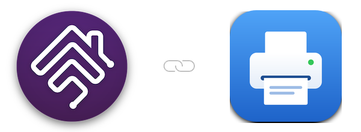

   

## homebridge-printer

Homebridge plugin to show HP and other AirPrint printers in Apple Home, with ink levels and a live dashboard

 

### Plugin Information

- This plugin shows your network printers in Apple Home. It was made for HP printers, and works with most printers that support AirPrint (IPP). The plugin:
  - reads the printer locally over IPP - no account or cloud needed
  - shows a **Printing** switch that is on only while a job is printing, and an **Online** switch that is on while the printer is reachable
  - shows one tile per ink or toner cartridge, with a low-ink alert
  - adds Eve app print history
  - can show **estimated watts and kWh** for the printer, over Matter (Homebridge `v2.3` or above)
  - adds a live dashboard of ink levels and status, on the plugin's settings page and at `http://<homebridge>:8587/`
- It replaces [homebridge-printer](https://www.npmjs.com/package/homebridge-printer) by SeydX, which no longer works with Homebridge `v2` - see [Coming from homebridge-printer](https://github.com/homebridge-plugins/homebridge-printer/wiki/Coming-From-Homebridge-Printer).

### Prerequisites

- To use this plugin, you will need to already have:
  - [Node](https://nodejs.org): latest version of `v22`, `v24` or `v26` - any other major version is not supported.
  - [Homebridge](https://homebridge.io): `v1.11.4` or above, or `v2` - refer to link for more information and installation instructions.
  - For estimated watts in the Home app: Homebridge `v2.3` or above with Matter turned on, and iOS `27` or above.

### Setup

- [Installation](https://github.com/homebridge-plugins/homebridge-printer/wiki/Installation)
- [Configuration](https://github.com/homebridge-plugins/homebridge-printer/wiki/Configuration)
- [Beta Version](https://github.com/homebridge-plugins/homebridge-printer/wiki/Beta-Version)
- [Node Version](https://github.com/homebridge-plugins/homebridge-printer/wiki/Node-Version)

### Features

- [Supported Printers](https://github.com/homebridge-plugins/homebridge-printer/wiki/Supported-Printers)
- [Energy and Matter](https://github.com/homebridge-plugins/homebridge-printer/wiki/Energy-and-Matter)
- [Dashboard](https://github.com/homebridge-plugins/homebridge-printer/wiki/Dashboard)

### Help/About

- [Common Errors](https://github.com/homebridge-plugins/homebridge-printer/wiki/Common-Errors)
- [Support Request](https://github.com/homebridge-plugins/homebridge-printer/issues/new/choose)
- [Changelog](https://github.com/homebridge-plugins/homebridge-printer/blob/latest/CHANGELOG.md)

### Credits

- To [@Wazza151](https://github.com/Wazza151): the creator of this version of the plugin.
- To [@SeydX](https://github.com/SeydX): the creator of [homebridge-printer](https://github.com/SeydX/homebridge-printer), which this plugin is based on.
- To the creators/contributors of [Homebridge](https://homebridge.io) who make this plugin possible.

### Disclaimer

- I am in no way affiliated with HP or any other printer maker and this plugin is a personal project that I maintain in my free time.
- Use this plugin entirely at your own risk - please see licence for more information.
