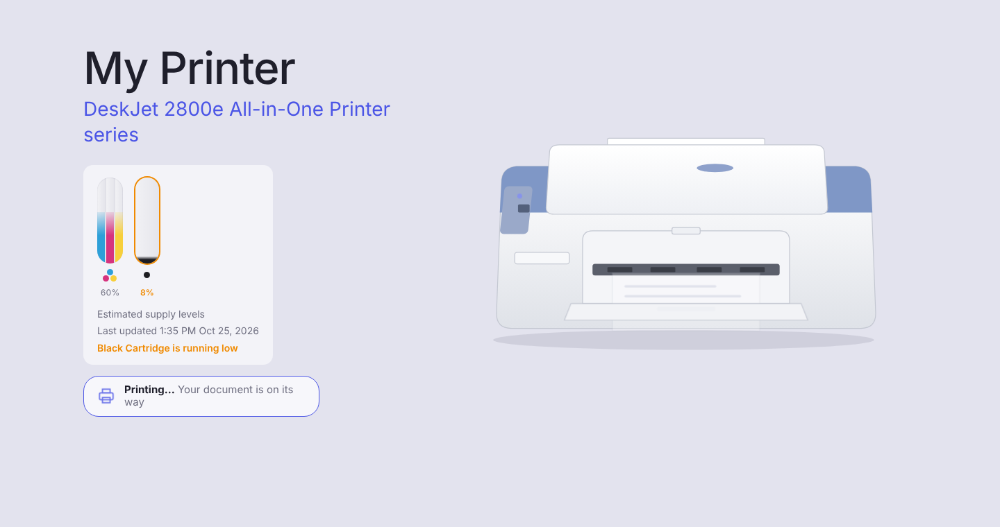
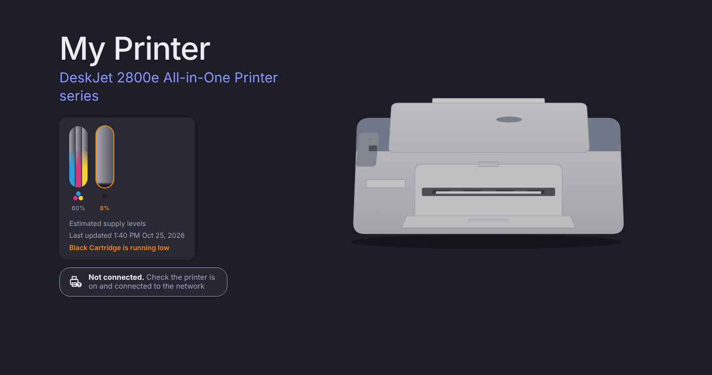
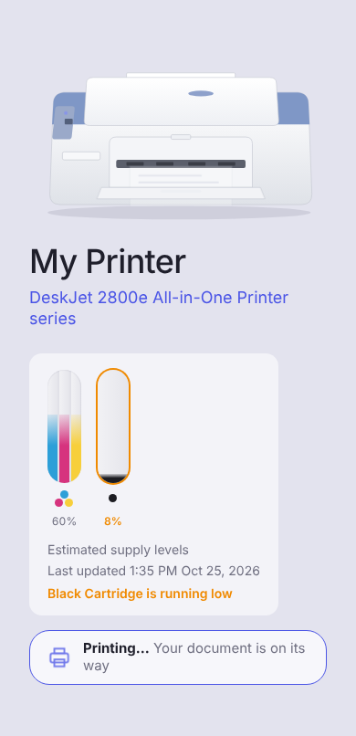

# homebridge-hp-printer

HP printers in Apple Home, with a live ink & status dashboard.
Works with **Homebridge 1.8+ and Homebridge 2.x** (tested on 1.8.5 / HAP-NodeJS 0.12.3 and 2.4.0 / HAP-NodeJS 2.2.3).

Based on [seydx/homebridge-printer](https://github.com/seydx/homebridge-printer) (MIT), rewritten to fix
[issue #26](https://github.com/seydx/homebridge-printer/issues/26) (`Class constructor Service cannot be invoked without 'new'` on Homebridge 2).



## What you get

| In the Home app | What it does |
| --- | --- |
| **Switch 1 – Printer Online** | On while the printer is switched on and reachable on your network; off when it's switched off or disconnected. Turn it on or off in Settings. |
| **Switch 2 – Printer Printing** | **On only while a print job is actually printing**, off when idle, asleep, switched off, or busy with maintenance such as head cleaning. Turn it on or off in Settings. |
| **Printer** sensor | The same printing state as a contact sensor (used for Eve history), and shows a fault when the printer is off, stopped or jammed. |
| One **ink tile per cartridge** | Filter-maintenance tiles with the level in % and a "replace" alert when ink drops below your threshold (default 10 %). |
| Eve app history | Print history graph and "times printed" counter in the Eve app. |

Both switches show status only: tapping one snaps it back, because a printer can't be switched on/off or
started over the network. Use them as automation triggers ("when Printer Printing turns on, turn on the desk lamp").

**Dashboard** – ink tubes, printing/idle/offline status and paper/jam warnings, at the top of the plugin's
Settings page in the Homebridge UI and full-screen at **`http://<your-homebridge-host>:8587/`**. Handy on a wall
tablet; it updates live and follows your device's dark mode.

Last-known ink levels are kept while the printer is switched off.

| Offline (dark mode) | Phone |
| --- | --- |
|  |  |

## Energy in Apple Home (Homebridge 2.3+ with Matter)

With Matter turned on, **Switch 1 (Printer Online)** becomes a Matter outlet that does two jobs. It's on while
the printer is reachable, and it shows the printer's power in watts plus a running kWh total, which feeds the
Home app's **Electricity** view (iOS 27 or later). With Matter off, Printer Online stays a regular HomeKit switch.
If you untick Switch 1, the outlet is called **Printer Energy** instead.

- **It's an estimate.** Printers don't report their real power use, only what they're doing. The plugin
  multiplies time spent in each state by a wattage. The defaults are HP's figures for the DeskJet 2800 series:
  ready 2.8 W, sleep 1.4 W and off 0.3 W. HP doesn't publish a printing figure, so 10 W is a guess.
  Change them under **Energy in Apple Home** in Settings. For real figures, use a smart plug with energy
  monitoring instead.
- **What Apple shows:** watts on the outlet tile (the outlet is published the way certified Matter plugs are, as a
  device with an outlet inside it, which is what Apple needs to put the watts on the tile), and the energy added to your home's total. Apple lists only
  directly paired devices by name in the Electricity view, so a bridged printer adds to the total but isn't
  listed separately.
- **The outlet shows whether the printer is on.** A printer can't be switched over the network, so tapping
  it in Home makes it flip back. Once it moves to Matter, the old HomeKit Printer Online switch is removed, so
  re-add the outlet to any automations that used the switch.
- **Turning it on** (no child bridge needed):
  1. You need Homebridge 2.3 or newer.
  2. In the Homebridge UI, open **Settings → Matter Settings**, turn **Matter** on for the main bridge, and restart.
  3. On the Homebridge UI **Status** page, find the Matter QR code. In the Home app, tap **+ → Add Accessory** and
     scan it. This is a separate pairing from the HomeKit one, and your existing accessories stay as they are.
  4. The Homebridge log then says `Energy in Apple Home: "Printer Online" is published over Matter.`
     If something is missing, the log says what.
  - If you run HP Printer as a child bridge, turn Matter on in its **Child Bridge Config** (plugin card → ⋮)
    instead. Note that ⋮ only shows **Child Bridge Config** once a child bridge exists. You don't need one for
    this feature.
- The estimate is also shown on the dashboard, with or without Matter.

## Matter only (optional)

Turn on **Matter only** in Settings → *Apple Home connection* to publish the printer to Apple Home over Matter
alone, with no HomeKit accessories from this plugin:

| HomeKit (default) | Matter only |
| --- | --- |
| Switch 1 Printer Online | **Printer Online** Matter outlet, with watts and kWh when energy is on |
| Switch 2 Printer Printing | **Printer Printing** Matter outlet, on only while printing |
| Printer sensor and ink tiles | Not available. Apple Home has no Matter tile for ink, so ink levels show on the dashboard and the Settings page |

It only takes effect when Matter is available: Homebridge 2.3+, Matter turned on in **Settings → Matter
Settings**, and the Matter bridge added to the Home app. Until then the HomeKit accessories are kept, and the
log says why. When it does take effect, the HomeKit accessories are removed, so put the Matter ones in their
rooms and re-add them to automations.

## Install

Copy `homebridge-hp-printer-2.7.0.tgz` to your Homebridge machine, then in a terminal (or the Homebridge UI's
terminal, top-right menu → *Terminal*):

```bash
sudo npm install -g --omit=dev ./homebridge-hp-printer-2.7.0.tgz
```

If your Homebridge runs from its own folder (the official Raspberry Pi image / `hb-service`), install it there instead:

```bash
cd /var/lib/homebridge && sudo -u homebridge npm install ./homebridge-hp-printer-2.7.0.tgz
```

Restart Homebridge, then open **Plugins → HP Printer → Settings**.

## Configure

Open the Homebridge UI, go to **Plugins**, find **HP Printer** and click **Settings**. The page has two parts:

**At the top**: a live dashboard with ink levels and status, plus
- **Find printers on my network**: lists the printers it finds; click **Add** to fill in the address for you.
- **Test connection**: checks each printer's address and shows the model and ink levels, or what's wrong.
- **Open full-screen dashboard**: opens the dashboard page on port 8587.

**Below**: the settings form.

1. Type your printer's **IP address** (e.g. `192.168.1.20`) or **.local name** (e.g. `HP7A1B2C.local`), or use
   **Find printers on my network** → **Add**. That's the only thing you have to fill in.
2. Click **Test connection** to check it.
3. Click **Save**, then restart Homebridge.

The printer shows up in the Home app as "Printer", "Printer Online" and "Printer Printing". Untick **Switch 1** or
**Switch 2** under the address to hide either switch. Rename them in the Home app, or fill in the optional *Name* field.
**More options** under each printer has the low-ink warning level, check interval (default 5 seconds), ink tiles,
and Eve history. **Add another printer** adds a second one.

The address can also be a full IPP URL (`ipp://192.168.1.20/ipp/print`). For HP printers the `/ipp/print` path is
found automatically, printers that insist on encrypted IPP (`ipps`) are handled, and `.local` names work even on
systems that can't normally resolve them.

**Finding the address:** print the printer's *Network Configuration* page, look in HP Smart under
*Printer Settings → Network Information*, or run `ippfind` in Terminal on a Mac.

If you prefer editing JSON (Homebridge UI → **JSON Config**), the block looks like this:

```json
{
  "platform": "HPPrinter",
  "name": "HP Printer",
  "printers": [
    {
      "address": "192.168.1.20",
      "name": "My Printer",
      "polling": 5,
      "marker": true,
      "lowInkThreshold": 10,
      "onlineSwitch": true,
      "printingSwitch": true,
      "history": true
    }
  ],
  "dashboard": { "enabled": true, "port": 8587 }
}
```

| Option | Default | Notes |
| --- | --- | --- |
| `address` | – | **Required.** IP, `.local` name or IPP URL. |
| `name` | `Printer` | Name in the Home app. |
| `polling` | `5` | Seconds between status checks (min 2). Checks every 2 seconds while printing. |
| `marker` | `true` | Ink/toner tiles in HomeKit. The dashboard always shows ink. |
| `lowInkThreshold` | `10` | % at which a cartridge is flagged low (the printer's own low mark is used if higher). |
| `onlineSwitch` | `true` | Switch 1: "Printer Online". |
| `printingSwitch` | `true` | Switch 2: "Printer Printing". |
| `history` | `true` | Eve history (via fakegato-history). |
| `manufacturer`, `model`, `serialNumber` | detected | Shown in accessory details. |
| `dashboard.enabled` / `dashboard.port` | `true` / `8587` | Built-in web dashboard. |
| `debug` | `false` | Extra logging without starting Homebridge in debug mode. |

### Coming from homebridge-printer

Uninstall `homebridge-printer`, install this, and copy your printers across. The platform is now
`"HPPrinter"`; the old `"printer"` array name is still accepted. Accessories are new, so re-add them
to rooms/automations once.

## Troubleshooting

* **"Not connected" on the dashboard** – check you can open `http://<printer-ip>` in a browser from the
  Homebridge machine; make sure IPP is enabled in the printer's web page (*Network → Advanced → IPP*).
* **No ink shown** – some printers only report levels after a first print or when awake. HP
  "instant ink"/setup cartridges sometimes report "unknown" (`?`).
* **Port 8587 in use** – change the port in Settings → *Dashboard web page*.
* **`.local` name not found** – the printer and Homebridge must be on the same network (not a guest Wi-Fi);
  use the IP address instead.
* **Save button greyed out** – a printer is missing its address. Fill it in, or remove that printer.

## Development

Plain JavaScript (CommonJS), no build step. Runtime dependency: `fakegato-history` (Eve history).

```bash
npm install
npm test        # unit tests: IPP encoder/parser, ink parsing, mDNS discovery, printing-state logic
```

End-to-end tests run the plugin inside a built copy of Homebridge (`dist/` from its repo) against a real IPP
server. CUPS's `ippeveprinter` works well as a test printer:

```bash
# test printer on port 8631; test/printcmd.sh reports ink levels and makes each job take ~8 s
ippeveprinter -p 8631 -M HP -m "DeskJet 2800e" -c test/printcmd.sh -F application/pdf -f application/pdf,text/plain "HP Test"
# (the ink levels appear after the first print job)

HB_DIR=/path/to/homebridge HAP_DIR=/path/to/hap-nodejs \
PRINT_CMD="ipptool -q -f doc.txt ipp://127.0.0.1:8631/ipp/print print-job.test" \
node test/e2e.mjs        # HomeKit side: accessories, switches, ink, restart/cache, offline (Homebridge 1.8 and 2.x)

HB_DIR=/path/to/homebridge PRINT_CMD="…" node test/energy.mjs
                         # Matter side: energy outlet, Matter only (uses a stand-in for api.matter that
                         # enforces Homebridge 2.4's Matter rules; matter.js itself is not exercised)
```

`test/configui-host.mjs` emulates the Homebridge UI's custom-settings host (with the official
`plugin-ui-utils` `ui.js`) to drive the settings page in a browser; `test/fake-mdns-printer.js` answers
Bonjour queries like an HP printer for testing discovery and `.local` names.

**Code map:** `src/ipp.js` (IPP client) · `src/poller.js` (status, ink, printing state) ·
`src/accessories.js` (HomeKit) · `src/energy.js` (Matter outlets, energy estimate) · `src/discovery.js`
(Bonjour) · `src/dashboard-server.js` (port 8587) · `homebridge-ui/` (settings page and dashboard).

**Not yet verified on real hardware:** the Matter side against a real Apple Home, and Apple Home's tile
wattage. The HomeKit side was tested against real Homebridge 1.8.5 and 2.4.0 and a CUPS test printer, not a
physical HP printer.

What changed for Homebridge 2: custom characteristics are real `class … extends Characteristic`, use
`hap.Formats/Perms/Units` (the old `Characteristic.Formats` aliases are gone), the built-in
`Service.ContactSensor` is no longer overwritten, all handlers use `onGet/onSet` (no callback API), the
old switch-lookup bug is fixed, and the unmaintained `@sealsystems/ipp` and `moment` dependencies were
replaced with a small built-in IPP client.

MIT licence.
